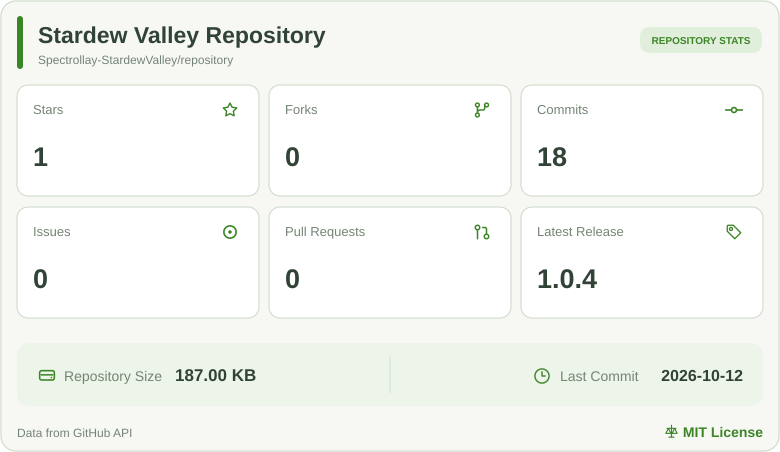

简体中文 | <a href="README-en_US.md">English</a> 语言翻译不一定 100% 准确

# 🌾 星露谷物语版本库 🌾

### 收集与整理星露谷物语历史版本及相关资料

#### 版本归档 · 信息整理 · 持续更新

<a href="https://stardewvalley.spectrollay.com/stats/" target="_blank" rel="noopener noreferrer">
  <picture>
    <source media="(prefers-color-scheme: dark)" srcset="stats/repository-stats-dark.svg">
    
  </picture>
</a>

---

## 📖 项目简介

**星露谷物语版本库**是一个非官方的星露谷物语（Stardew Valley）历史版本归档项目，致力于整理游戏版本信息、更新记录及相关资源的获取途径，为玩家提供便捷、直观的版本查询与下载服务。

目前版本库主要收录 **Android** 平台的游戏版本，未来将根据实际情况逐步扩展其他平台。

---

## ✨ 主要特性

- **历史版本归档**：集中整理不同版本的基本信息与获取途径。
- **版本资料查询**：提供版本编号、发布日期、更新说明等相关记录。
- **文件信息展示**：整理文件大小、适用架构及校验信息等资料。
- **持续补充完善**：修正错误记录，补充缺失版本与历史资料。

---

## 🖥️ 在线访问

无需下载或配置，直接访问项目网站，即可浏览版本库中的内容：

### 🌐 [星露谷物语版本库](https://stardewvalley.spectrollay.com/)

> [!NOTE]
> 版本库中的部分历史资料可能存在缺失或错误。如果你掌握相关版本信息、更新说明或资源线索，欢迎与开发者取得联系，帮助我们完善内容。

---

## 💬 反馈与交流

如果你发现版本信息错误、下载链接失效或网站功能异常，或者希望收录新的游戏版本、补充现有版本资料、提出功能建议，请通过 [**GitHub Issues**](https://github.com/Spectrollay-StardewValley/Repository/issues) 反馈。

如果希望提供历史安装文件或其他资源线索，也可以与开发者取得联系。

---

## 📜 开源许可

本仓库中由项目开发者提供的代码基于 [**MIT 协议**](LICENSE) 授权。游戏本体、游戏资源及第三方文件不属于该许可的授权范围，其相关权利归各自权利人所有。

---

**© Spectrollay | 用❤️制作**

本项目为非官方项目，与 ConcernedApe 及星露谷物语官方没有隶属关系。

